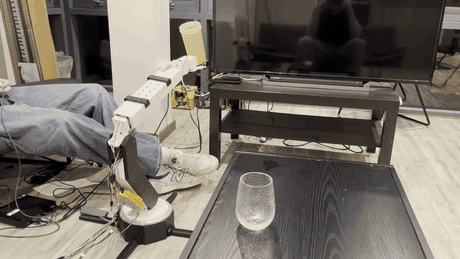
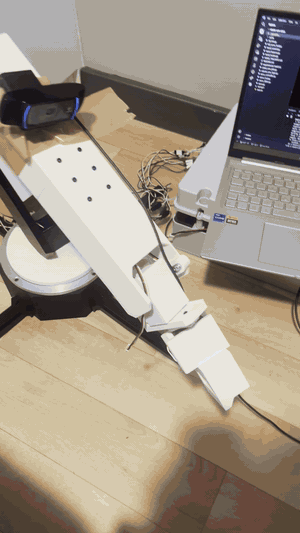
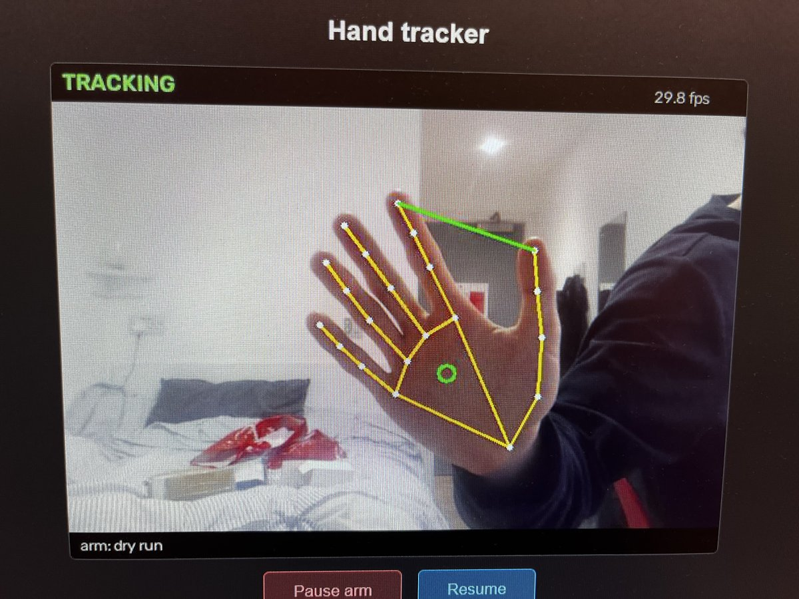
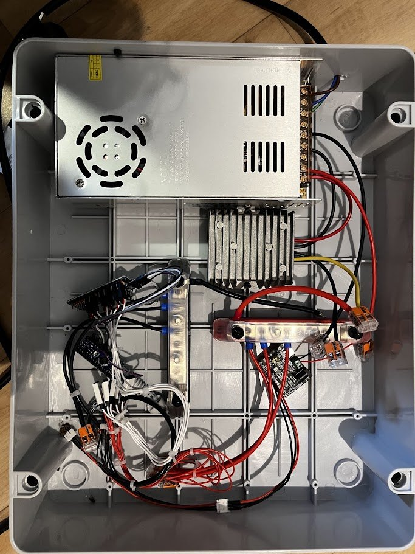
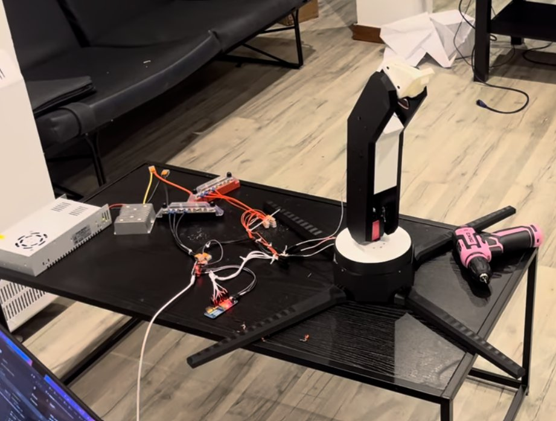
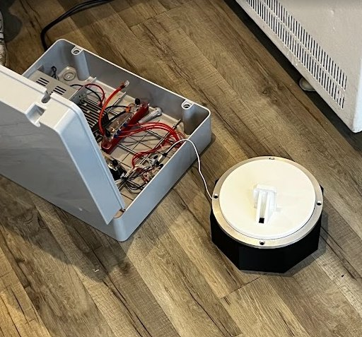

# Robotic Arm Vision

**A 3D printed 6-axis robotic arm you can control from a web page, an Xbox controller, or just by moving your hand in front of its camera.**

   



## What it does

- **Moves to a point in space.** Give it an X/Y/Z position and a pitch, yaw and roll for the gripper, and the inverse kinematics works out every joint angle. Targets the servos can't reach are rejected.
- **Web control panel.** Sliders for position, orientation and the gripper, plus live graphs of the gripper servo's temperature, voltage and load.
- **Xbox controller.** Drive the arm in real time with the sticks and triggers.
- **Follows your hand.** A webcam on the arm finds your hand and moves to keep it centred. A fist stops it and a pinch closes the gripper.
- **Lines up with paper for drawing.** The camera finds a sheet of A4, then centres, squares and sets the height of the arm over it.
- **Smooth, synchronised moves.** All joints start and finish each move together.
- **3D simulator.** Try out moves on screen without any hardware.

## Demo

### Hand tracking



The camera on the arm follows a hand, and the screen shows what it sees.

### Photos

| | |
|---|---|
|  |  |
| The hand tracker's camera view, finding the hand and palm centre | Inside the electronics box: power supply, step-down converter and servo controllers |
|  |  |
| An early build, before the upper arm and gripper | The rotating base next to the electronics box |

## How it works

Everything goes through one Flask server (`server/full_servo_hud.py`), and that server is the only part that talks to the servos. The web panel, Xbox controller, hand tracker and paper aligner all send it target positions over HTTP.

```
Web panel / Xbox controller / Hand tracker / Paper aligner
        │  HTTP (/ik, /pincher)
        ▼
  Flask server  →  inverse kinematics  →  serial  →  servos
```

**Inverse kinematics.** The wrist position is found by working back from the target along the gripper's direction. The shoulder and elbow angles are then searched for the closest match, and the forearm, wrist and hand joints set the final direction and roll.

**Hand tracking.** Each camera frame goes through MediaPipe's hand landmark model, and the centre of the palm is compared with the centre of the image:

- Outside a central dead zone, the arm moves towards the hand at a fixed, slow speed.
- The dead zone has hysteresis so the arm doesn't jitter at its edge.
- A closed fist, or no hand in view, stops the arm.
- A thumb-index pinch closes the gripper.

A live camera view with the tracking overlay is shown in the browser.

## Hardware

| Part | Notes |
|---|---|
| 3D printed arm | STL files in [`cad/`](cad/) |
| 6 hobby servos | Driven by a USB serial servo controller |
| Feetech smart servo | The gripper, with position, temperature and load feedback |
| Logitech C920 webcam | Mounted on the arm |
| Xbox controller | Optional |
| PC | Runs the server on Ubuntu, or WSL on Windows |

### 3D printing

The STL files for every printed part are in [`cad/`](cad/).

<!-- Fill in: material, layer height, infill, supports, and anything that needs extra care (e.g. the gripper) -->
| Setting | Value |
|---|---|
| Material | PLA |
| Layer height | 0.2 mm |
| Infill | 20% |
| Supports | |

## Getting started

### 1. Install

```bash
git clone https://github.com/joeFerguson3/robotic-arm-vision.git
cd robotic-arm-vision
python3 -m venv .venv
source .venv/bin/activate
pip install -r requirements.txt
```

### 2. Connect the servos (Windows / WSL only)

The server runs on Linux. On Windows, WSL can't see USB devices by default, so pass the two servo controllers through with [usbipd-win](https://github.com/dorssel/usbipd-win). In PowerShell as administrator:

```powershell
usbipd list                        # find the BUSID of each servo controller
usbipd bind --busid <BUSID>
usbipd attach --wsl --busid <BUSID>
```

In WSL, check they've appeared with `ls /dev/ttyUSB* /dev/ttyACM*`.

### 3. Set the serial ports

Open `server/full_servo_hud.py` and check the ports at the top match your setup:

```python
HOBBY_PORT = "/dev/ttyUSB0"    # hobby servo controller
SMART_PORT = "/dev/ttyACM0"    # gripper smart servo
```

If you get a permission error, add yourself to the `dialout` group with `sudo usermod -aG dialout $USER`, then restart the terminal.

### 4. Start the server

```bash
python3 server/full_servo_hud.py
```

Open the control panel at `http://localhost:8080`. The server listens on the whole network, so you can also use `http://<pc-ip>:8080` from a phone.

### 5. Choose how to control it

With the server running, start any of these in a second terminal.

**Hand tracking** (Python 3.9–3.12)
```bash
pip install -r hand_tracking/requirements.txt
python hand_tracking/hand_tracker.py --dry-run   # watch the tracking without moving the arm
python hand_tracking/hand_tracker.py             # for real
```
Camera view: `http://localhost:8090`. See [`hand_tracking/README.md`](hand_tracking/README.md) for the controls and settings.

**Xbox controller** (Linux)
```bash
pip install evdev
python3 controllers/servo_controller.py
```

**Paper alignment for drawing**
```bash
python drawing/paper_align.py --dry-run
```
See [`drawing/README.md`](drawing/README.md).

**Simulator** (no hardware needed)
```bash
pip install matplotlib
python3 simulation/3d_sim.py
```

### Optional: control the PC from your phone

`tools/start.ps1` (Windows) and `tools/start.sh` (WSL) open the WSL terminal as a web page on port 7682, so you can start and stop the scripts from another device on your network.

## Server API

| Endpoint | Method | What it does |
|---|---|---|
| `/` | GET | The web control panel |
| `/ik` | POST | Move the gripper to a position and orientation |
| `/pincher` | POST | Open or close the gripper |
| `/state` | GET | The last position sent to the arm |
| `/metrics` | GET | Gripper servo readings (temperature, voltage, load) and recent history |
| `/temperature` | GET | Gripper servo temperature |

## Project files

| Folder | What's in it |
|---|---|
| `server/` | The Flask server (`full_servo_hud.py`), the inverse kinematics (`robotic_arm_logic.py`) and the servo drivers (`servo.py`). |
| `controllers/` | The Xbox controller client. |
| `hand_tracking/` | Hand detection with MediaPipe (`hand_tracker.py`), hand gestures (`hand_features.py`) and turning hand position into arm moves (`hand_control.py`). |
| `drawing/` | Finding a sheet of paper and lining the arm up with it. |
| `simulation/` | The 3D simulator. |
| `tools/` | Single-servo test tools and the web terminal scripts. |
| `cad/` | STL files for the printed parts. |
| `docs/media/` | Photos and GIFs used in this README. |

## Troubleshooting

| Problem | Fix |
|---|---|
| `could not open port /dev/ttyUSB0` | The controller isn't attached to WSL (step 2), the port name is different (step 3), or another script already has the port open. |
| `Permission denied` on the serial port | Add yourself to `dialout` (step 3). |
| Hand tracker won't install | MediaPipe needs Python 3.9–3.12. |
| An axis moves the wrong way when following | Flip `SIGN_H` or `SIGN_V` at the top of `hand_tracking/hand_control.py`. |
| Can't open the web pages from another device | Check the PC's firewall, and on WSL use mirrored networking (`tools/start.sh` tells you how). |

## Safety

The arm can move quickly. Keep clear of it when it powers on, test new code with `--dry-run` or the simulator first, and keep a hand near the power switch.

## Roadmap

- Fix the shoulder joint range in the IK search so the arm can reach its full workspace
- Work out the pen tip's position from the camera, then draw shapes and images
- Finish colour-based pick and place
- Add distance tracking to hand following
- Add a login to the web interface

## Built with

Python, Flask, OpenCV, MediaPipe, NumPy and PySerial, with a plain HTML/JavaScript control panel.

## Authors

- [Franck Blackler](https://github.com/Fblackler)
- [Joe Ferguson](https://github.com/joeFerguson3)
